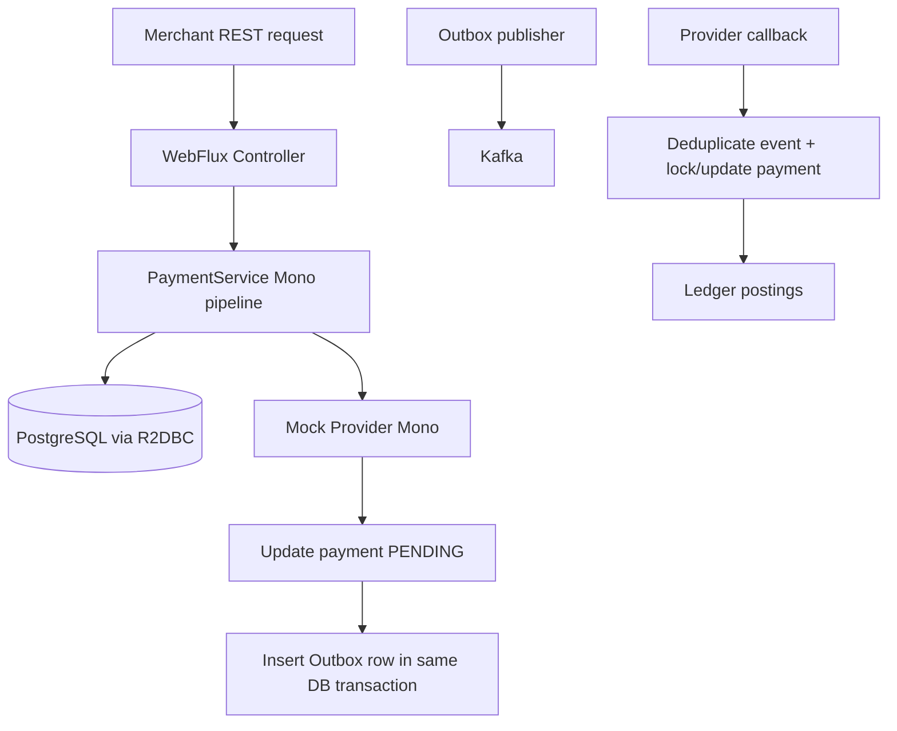

# PayCore — Kotlin + Spring WebFlux + Project Reactor

A deliberately small, learning-first payment orchestration project using the style of backend work you have described: Kotlin, Spring WebFlux, `Mono`, `Flux`, Reactor operators, PostgreSQL and asynchronous provider calls.

> **Portfolio honesty:** This is a learning project, not a production payment gateway. It uses a mock provider, does not connect to UPI/banks/cards, and is not security/compliance certified. Run and test it yourself before describing it as implemented.

## Why this version?

Instead of translating everything into Java MVC, this version keeps the reactive programming model visible:
- Controller methods return `Mono<T>`.
- Service methods compose work using `map`, `flatMap`, `onErrorResume`.
- Provider integration is asynchronous and returns `Mono<ProviderResult>`.
- PostgreSQL access uses R2DBC (non-blocking database driver).
- `TransactionalOperator` wraps a reactive transaction.
- No `.block()` is used in application request paths.

## Request flow



## Learn the Reactor chain

Example service flow:

```kotlin
provider.initiate(command)
    .flatMap { providerResult -> repository.markPending(payment.id, providerResult.reference) }
    .flatMap { updated -> outbox.save(paymentInitiatedEvent(updated)).thenReturn(updated) }
    .onErrorResume { error -> markForReviewOrPropagate(error) }
```

- `map`: transform a value synchronously.
- `flatMap`: call another asynchronous operation that returns `Mono`/`Flux`.
- `then`: ignore the previous value and wait for completion.
- `doOnNext` / `doOnSuccess`: side-effect hooks for logging/metrics, not for core business logic.
- `onErrorResume`: recover by switching to another publisher.
- `Mono`: zero or one result.
- `Flux`: zero to many results.

## Run locally

Requirements: JDK 21, Gradle 8.10+, Docker Compose.

```bash
docker compose up -d postgres
./gradlew bootRun
```

API: `http://localhost:8080`

Create payment:
```bash
curl -X POST http://localhost:8080/api/v1/payments \
  -H 'Content-Type: application/json' \
  -H 'Idempotency-Key: demo-order-1' \
  -d '{"merchantId":"merchant-demo","amount":120.00,"currency":"INR","paymentMethod":"UPI"}'
```

Check status:
```bash
curl http://localhost:8080/api/v1/payments/{paymentId}
```

Simulate provider callback:
```bash
curl -X POST http://localhost:8080/api/v1/provider/callbacks/mock \
  -H 'Content-Type: application/json' \
  -d '{"providerEventId":"evt-demo-1","paymentId":"PAYMENT_UUID","status":"SUCCESS"}'
```

## Core design

- **Idempotency:** PostgreSQL unique constraint on `(merchant_id, idempotency_key)`. Redis locks alone are not a correctness guarantee.
- **State machine:** `CREATED -> PENDING -> SUCCESS | FAILED`. A successful payment may later be refunded through a separate compensating operation.
- **Ledger:** a capture writes a debit and a credit with equal amount and currency in one transaction.
- **Outbox:** payment update and event record commit together. A publisher sends events later. Delivery is at-least-once; consumers deduplicate by `event_id`.
- **Concurrency:** database uniqueness protects create races. Production callback handling should use row locking or conditional updates and idempotent ledger posting.

## Important simplifications

This starter keeps the first learning pass understandable. It does not yet include Redis caching, production Kafka publishing, refund execution, signature verification, merchant authentication, settlement, reconciliation, fraud controls, secrets management or operational hardening. See `docs/next-steps.md`.

Do not claim 1,000 RPS / 180 ms p95 unless you run a reproducible benchmark and document the hardware, data volume, concurrency, duration, request mix, errors and percentiles.
